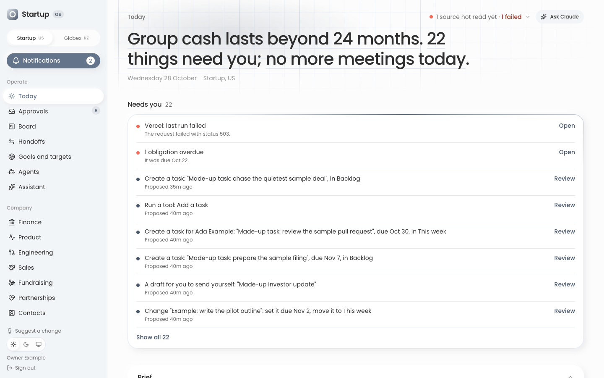

# Startup OS

Startup OS is one place to run a small company. It is for a founder and a small team: the founder
(the **owner**) sees everything, and each teammate sees only the pages the owner gives them.

It answers two questions every day: *what needs me?* and *how is the company doing?* It
gathers the company's numbers (cash, burn, runway, revenue, sales and fundraising pipelines,
product use, pull requests, marketing) from the tools you already use, sets them against
published benchmarks, and keeps the work that acts on them: goals, a task board, decisions and
meeting notes. AI agents and bots can read it too, but they only **propose** changes. Nothing
they suggest happens until the owner approves it.

"Startup OS", "Startup" and "Globex" are placeholders. This repository is a template, published from
a company's own operating system with its names and data taken out. Every figure and name in
the pictures below is made up.



## What you get

| Module | What it does |
|---|---|
| **Today** | The start page. One line on runway and what waits for you, a ranked "Needs you" list, the daily brief, your own day, then the company's numbers. |
| **Goals and targets** | The quarter's goals with their status, and the target each scorecard number is held to. |
| **Board** | Tasks in four columns: Backlog, This week, Doing, Done. Bots and people add cards. |
| **Approvals** | Everything agents and bots wait on the owner for, in one inbox. Approve, edit, or reject with a reason. |
| **Finance** | Cash ÷ net burn = runway, revenue, all costs, unit economics, and a budget with runway scenarios. |
| **Payroll and Costs** | What the company pays its people and everything else. The owner's alone, always. |
| **Sales, Fundraising, Partnerships** | Pipelines of deals, investors and partners, each as a board or a table. |
| **Customers and Contacts** | Customers with a health verdict, and the company's business contacts. |
| **Product and Engineering** | Who uses each product week by week, and where each pull request stands. |
| **Go to market and LinkedIn** | Search and outbound figures, and a calendar of LinkedIn posts. |
| **Compliance** | Dates to keep, security questionnaires, vendor agreements and evidence. |
| **Memory** | Decisions and why they were made, and meeting notes. |
| **Agents and Assistant** | Four built-in AI agents (chief of staff, engineering, sales, finance), your own bots, and a chat with your own Claude. |
| **Settings** | Your team and what each person sees, where each number comes from, and the Telegram bot. |

The guide's [page-by-page tour](docs/guide/tour.md) says what each page is for and what fills
it.

| | |
|---|---|
|  |  |
|  |  |

The pictures show the template with its optional features turned on, so a second company
("Globex") appears in them. As shipped, the template runs for one company.

## Try it on your laptop in five minutes

This runs the whole app on your machine with made-up data. You need no account, no password
and no secret.

1. Install [Node.js 20 or newer](https://nodejs.org) and [pnpm](https://pnpm.io/installation).
2. Get the code and start it:

   ```bash
   git clone <this repository's URL> startup-os && cd startup-os
   pnpm install
   pnpm dev:local      # the app on http://localhost:3100, with made-up data
   ```

3. Leave that running. In a second terminal, sign in as the owner:

   ```bash
   pnpm dev:signin
   ```

   Your browser opens the app, signed in as "Owner Example". To see what a teammate sees,
   sign in as one instead: `pnpm dev:signin sales` (or `cofounder`, `engineer`, `marketing`,
   `success`). `pnpm dev:seed` puts the made-up data back as it was.

Stop it with Ctrl-C. Nothing you do here leaves your machine.

## Run it for your own company

To run it for real you need a free [Convex](https://www.convex.dev) account (the database),
a [Vercel](https://vercel.com) account (the website) and a Google sign-in client. Sign-in is
Google only.

**[`docs/setup.md`](docs/setup.md) takes you from a fresh copy to a running deployment**, step
by step: Convex, Google sign-in, Vercel, the owner's address, every setting by name, your name
and logo, connecting your data, and connecting Claude. Then
**[your first week](docs/guide/first-week.md)** is a checklist for getting the team going.

## Learn it

- **[How it works](docs/guide/overview.md)**: the core ideas in plain words. Start here.
- [A tour of every page](docs/guide/tour.md) · [Roles: who sees what](docs/guide/roles.md) ·
  [Your first week](docs/guide/first-week.md) · [Make it yours](docs/guide/customize.md)
- [Questions](docs/guide/faq.md) · [Words the app uses](docs/guide/glossary.md) ·
  [When something goes wrong](docs/guide/troubleshooting.md)
- Every document, for the team and for developers: **[the docs' index](docs/README.md)**.

## How it is built

A [Next.js](https://nextjs.org) web app on a [Convex](https://www.convex.dev) backend, which
holds the data, runs the scheduled syncs and checks who may see what on every request. Data
comes in two ways: the app reads some tools itself on a schedule (your bank, Linear, Apollo),
and scripts you run push the rest to one address, `POST /ingest/v1`. AI tools reach it through
a Model Context Protocol (MCP) server. Two files make it yours: `convex/lib/identity.ts` (names,
logo, currency) and `convex/lib/features.ts` (the optional features, all off as shipped).
[`CLAUDE.md`](CLAUDE.md) is the rulebook for changing the code, by hand or with Claude Code.

Want to help? Read [`CONTRIBUTING.md`](CONTRIBUTING.md). Found a security problem? Please
report it privately, as [`SECURITY.md`](SECURITY.md) says.

## License

[GNU Affero General Public License v3.0](LICENSE). You may use, change and share it. If you run
a changed version for other people over a network, you must offer them its source code.
