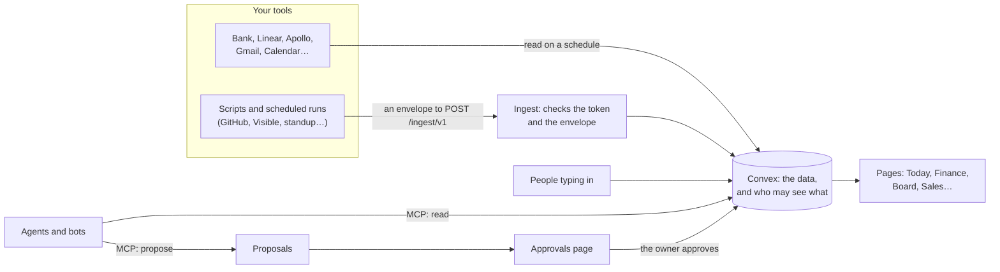

# How Startup OS works

This page explains the ideas behind Startup OS in plain words. Read it once before you set the
app up or invite anyone. The examples use the template's made-up company, which is simply called Startup, with
made-up numbers.

- [The scorecard and benchmarks](#the-scorecard-and-benchmarks)
- [Goals, targets and tasks](#goals-targets-and-tasks)
- [A weekly rhythm](#a-weekly-rhythm)
- [One company or two](#one-company-or-two)
- [The owner, teammates, roles and pages](#the-owner-teammates-roles-and-pages)
- [Where the data comes from](#where-the-data-comes-from)
- [Agents and bots only propose](#agents-and-bots-only-propose)
- [The MCP server: letting AI tools in](#the-mcp-server-letting-ai-tools-in)
- [How it fits together](#how-it-fits-together)

## The scorecard and benchmarks

The **scorecard** is the set of numbers that says how the company is doing: cash, burn,
runway, monthly recurring revenue (MRR), deals in the pipeline, weekly users of the product,
pull requests waiting for review, and more. Each number lives on the page it belongs to
(Finance, Sales, Product…), and Today shows a summary of the ones you may see.

Many numbers come with a **benchmark band**: the range that is typical for a company at
the same stage as yours (seed, say), taken from a published source. Every band names its source and the year. A tile
then says one of three things, always with an icon and a word, never by colour alone:

- *Stronger than typical for seed*
- *Typical for seed*
- *Weaker than typical for seed*

A rate gets no verdict until there is enough data behind it. If the company has had three demo calls
this month, the tile shows "3" and says why it gives no verdict yet.

Two rules hold everywhere:

- **A missing number is not a zero.** If the bank has not been read yet, Finance says *Not
  known yet*, never "$0". A total that is missing a part says which part is missing.
- **Every number says how fresh it is.** Each page has an "Updated …" line, and a source that
  is late or failing shows up on Today.

## Goals, targets and tasks

Three things turn numbers into work.

- A **target** is the number you have committed to for a scorecard figure. For example: "MRR
  of $60K by the end of the quarter". A tile reads on or off target against it. Benchmarks
  are separate: a target is your promise, a benchmark is what other companies typically do.
- A **goal** is what the company means to do this quarter, in words. For example: "Close the
  seed round". Each goal has a status (*on track*, *at risk*, *off track*, *done*), a quarter,
  and can have an owner, a due date and a target.
- A **task** is a card on the board. A card can say which goal it serves, so the goal shows
  how many tasks, deals and proposals work towards it.

The board has four columns: **Backlog** (not scheduled yet), **This week** (committed for this
week), **Doing** (in progress now) and **Done**.

## A weekly rhythm

Startup OS does not force a meeting on you, and a dedicated weekly review page is **not available
yet** (the address `/review` only sends you to Today). The pieces for a weekly rhythm are all
there, though. A routine that works for a small team:

| When | Who | What |
|---|---|---|
| Every morning | Owner | Open **Today**. Read the brief, then work down "Needs you". Clear **Approvals**. |
| Every morning | Each teammate | Open **Today** (or the first page you have) and the **Board**. Move your cards. |
| Monday | Owner and team | Look at **Goals and targets**: is each goal still on track? Change a status if not. Pull this week's cards from Backlog into **This week**. |
| Monday | Owner | Look at **Finance**: cash, burn and runway, and whether any source is late. |
| Friday | Everyone | Move finished cards to **Done**. Record any decision in **Memory**, with the reason. |
| Start of the quarter | Owner and co-founders | Write the quarter's goals and set the targets. |

The chief-of-staff agent writes a short **daily brief** for the owner (at most eight lines per
company). It appears on Today and in the archive on the Assistant page. When anything is waiting, a
daily message tells the owner how many approvals there are (in the app, and on Telegram if
you connect it).

## One company or two

As shipped, Startup OS runs for **one company** ("Startup"). It can also run for a second company
that the same founder runs, for example a subsidiary in another country ("Globex"). This is a
switch (`secondCompany`) that is off by default. With it on:

- a **company switch** appears in the sidebar, and each page shows the company you picked;
- Finance gets a **Group** view that adds both companies together, converting the second
  company's currency at a stored rate;
- each teammate can be put on one company or both, and sees only that company's rows.

The second company can keep its money in another currency. Today the app knows two: US
dollars and Kazakhstani tenge. [Make it yours](customize.md#add-a-second-company) says how to
turn the second company on.

## The owner, teammates, roles and pages

- **The owner** is the founder. The owner's Google address is set once, in the server's
  settings (`OWNER_EMAILS`). The owner always sees every page and both companies.
- **A teammate** is someone the owner adds on **Settings › Team**, by their Google address.
  Nobody else can sign in.
- **Pages** (called *areas* in the code) are what you give. The owner ticks, for each teammate,
  the pages they may open: Finance, Sales, Board, and so on. Everything else is hidden from
  them, and the server refuses it too, not only the menu.
- **A role** is a label and a starting set of ticks. Choosing "Sales" ticks Sales, Customers,
  Go to market, the Board and the scorecard. You can then tick or untick anything. A role
  grants nothing by itself. It also decides the order of the blocks on that person's Today.
- Some pages are special:
  - **Payroll** and **Costs** are the owner's alone, always. Nobody else can be given them.
  - **Settings** (sources, Telegram) and **Team** are *sensitive*: only the owner can give
    them, one person at a time, and no role includes them.
  - **Approvals** and **Assistant** are the owner's alone.

[Roles](roles.md) lists what each role starts with and a daily routine for each.

## Where the data comes from

Every number has exactly one **source**, the one place allowed to write it. There are three
kinds of source:

1. **Typed in.** People enter it on the page: a deal on Sales, a cost line on Costs, a goal.
   Some figures have no system to read them from (MRR, for example) and are typed in on
   Finance under *Record a figure*.
2. **Read by the app** (a *connector*). Startup OS reads the tool itself on a schedule once you
   set its key in the server's settings: the bank (Mercury), Linear, Apollo, Google Search
   Console, Fireflies, and the owner's own Gmail and Calendar.
3. **Pushed to the app.** A script or a scheduled job on a computer you control sends the data
   to one address, `POST /ingest/v1`, as a small JSON document called an **envelope**. Each
   source has its own secret token, and the token decides which source the envelope is for.
   GitHub pull-request counts, investors from Visible and standup tasks arrive this way.

**Settings › Sources** shows every source, how it arrives, when it last ran and whether it
worked. A teammate can also connect their own Claude to send their mail, calendar and meeting
notes, which only they see.

The app stores totals, not raw records: monthly money in and out, not each bank transaction.

## Agents and bots only propose

Startup OS has two kinds of AI helper:

- **The built-in agents.** Four of them: *chief of staff*, *engineering manager*, *sales and
  pipeline*, and *finance and compliance*. Each reads the numbers on a schedule (by default
  once a day) and suggests what to do. They run either through Claude Code on the owner's Mac
  or inside the app on a Gemini model. Each can be switched off.
- **Your own bots.** Any AI tool you connect, for example a research bot in Claude. The owner
  adds each bot on **Agents › Bots** and decides what it may read and write, page by page.

The rule for both: **an agent or bot proposes; the owner decides.** A suggestion such as
"Create a task: chase the quietest sample deal" becomes a **proposal**. It waits on the
**Approvals** page with the reason the agent gave, which goal it serves and how urgent it is.
The owner approves it (it happens, as if the owner did it), edits then approves it, or rejects
it with a reason the agent learns from. A **draft** (say, an investor update) is only ever text
for you to copy; nothing is sent anywhere.

After ten clean approvals of the same simple kind (creating a task, for example), the owner is
offered **earned autonomy**: that kind may then go through without a click. The owner can take
it back at any time.

Two other words you will meet:

- A **handoff** is one bot asking another bot, or a person, to take over a piece of work. It
  shows on the Handoffs page until it is accepted, done or declined.
- An **outcome** is what came of something a bot tried, such as a follow-up email to a deal:
  *worked*, *failed* or *pending*.

## The MCP server: letting AI tools in

The Model Context Protocol (MCP) is a standard way for AI tools such as Claude to use another
app. Startup OS speaks it at `/mcp/v1`. Once the owner connects Claude Code or claude.ai, Claude
can read the company's numbers, tasks and pipelines and, with permission, propose or make
changes.

- Only the owner can connect a client: with a token made on **Settings › Connections**, or by
  signing in from claude.ai.
- A token is either *read only* or *read and act*, and can be revoked at once.
- Every call is listed under *Recent calls*.
- Payroll, people's own mail and the team's settings are never given to any token.

## How it fits together

Next: [a tour of every page](tour.md), or [your first week](first-week.md).
