# A tour of every page

Every page in Startup OS, in the order of the sidebar. For each one: what it is for, who uses it,
what fills it, and which optional feature (a *switch* in `convex/lib/features.ts`) changes it.
Words in *italics* are the app's own labels. The [glossary](glossary.md) explains the terms.

**Who can open a page** is decided by the pages (areas) the owner ticks for each person on
Settings › Team. A teammate without a page does not see it in the sidebar, and the server
refuses its data too. [Roles](roles.md) has the starting set for each role.

**What fills a page** is one of three things: people typing in, a connector the app reads on a
schedule, or data pushed to `POST /ingest/v1` (an *envelope*). Agents and bots can also
*propose* changes, which wait for the owner on Approvals. [How it works](overview.md#where-the-data-comes-from)
explains the three.

The pictures show the made-up data of `pnpm dev:local`, with every optional feature turned on.

- **Operate:** [Today](#today) · [Approvals](#approvals) · [Board](#board) ·
  [Handoffs](#handoffs) · [Goals and targets](#goals-and-targets) · [Agents](#agents) ·
  [Assistant](#assistant)
- **Company:** [Finance](#finance) · [Product](#product) · [Engineering](#engineering) ·
  [Sales](#sales) · [Fundraising](#fundraising) · [Partnerships](#partnerships) ·
  [Contacts](#contacts) · [Customers](#customers) · [Compliance](#compliance) ·
  [Go to market](#go-to-market) · [LinkedIn](#linkedin) · [Memory](#memory) ·
  [Payroll](#payroll) · [Costs](#costs)
- **Settings:** [Sources](#settings--sources) · [Connections](#settings--connections) ·
  [Team](#settings--team) · [Telegram](#settings--telegram)
- [Addresses that only redirect](#addresses-that-only-redirect) ·
  [Pages that need a switch](#pages-that-need-a-switch)

---

## Operate

### Today

`/` · opens with the *scorecard* or *today* page ticked

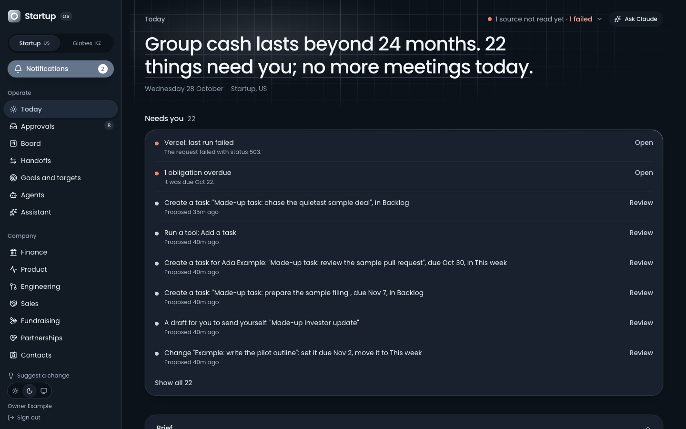

**For:** the start page. It answers "what needs me, and how is the company doing?"

**What is on it, top to bottom:**

1. **The opening line.** For example: *"Cash lasts beyond 24 months. 22 things need you; your
   next meeting is at 20:00."* Beside it, whether any source is late or failing.
2. **Needs you.** One ranked list of what waits on you: overdue tasks, failed sources, overdue
   compliance dates, proposals to review (the owner), tasks due today, review requests on pull
   requests, decisions due for another look, figures that have gone quiet, handoffs nobody has
   taken.
3. **Brief** (the owner only). The chief-of-staff agent's daily bullets. It hides once it is
   more than 36 hours old.
4. **Your day** (people with the *today* page). Meetings today, mail waiting on a reply and
   your Linear issues. These are yours alone: nobody else, not even the owner, sees them.
5. **The company.** A block per part of the company (money, customers, sales, fundraising,
   product, engineering, go to market, work, compliance), each shown only if you have that
   page. The order follows your role's *focus*: a salesperson sees deals first.

**Who uses it:** everyone, every morning.

**What fills it:** every other page, plus each person's own mail, calendar and notes once they
connect them (Settings › Connections).

### Approvals

`/approvals` · the owner's alone

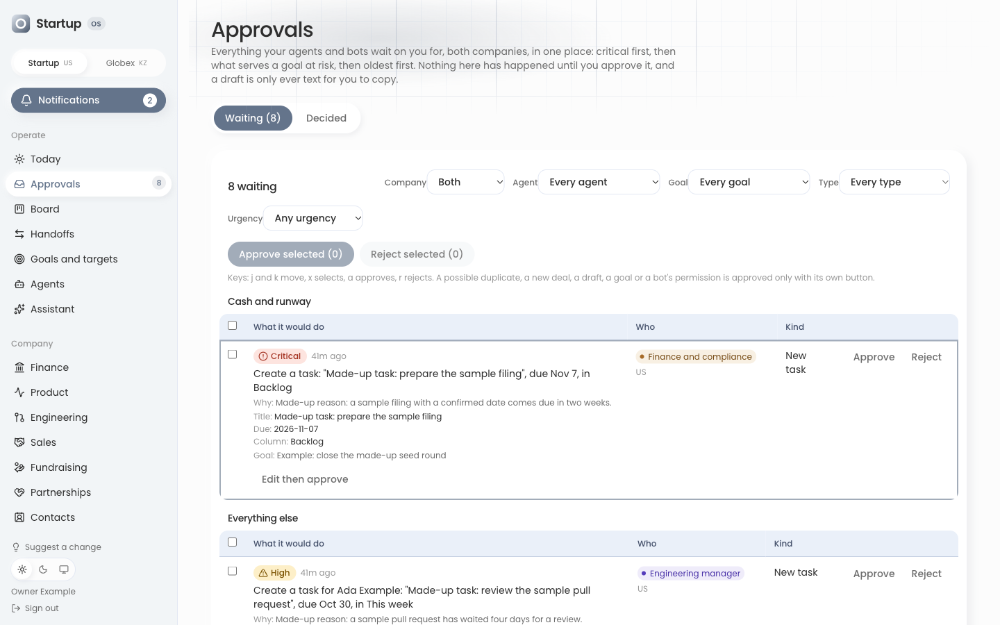

**For:** the one inbox for everything agents and bots want to do. *"Nothing here has happened
until you approve it, and a draft is only ever text for you to copy."*

**What is on it:**

- **Waiting:** each proposal with what it would do, *why* the agent wants it, the goal it
  serves, its urgency (*Critical*, *High*…) and its age. Proposals about cash and runway are
  pinned on top. Filter by company, agent, goal, type and urgency.
- Buttons: *Approve*, *Edit then approve*, *Reject* (with a reason: wrong timing, wrong data,
  not a priority, rewrite tone, duplicate, or your own words), and *Approve selected* for
  several at once. Keys: `j` and `k` move, `x` selects, `a` approves, `r` rejects.
- **Decided:** the last 30 days, including what went through by earned autonomy (with a flag
  to take that autonomy back).

**What fills it:** the built-in agents and your bots, through the MCP server. Nothing is typed
here except decisions.

### Board

`/board` · the *board* page

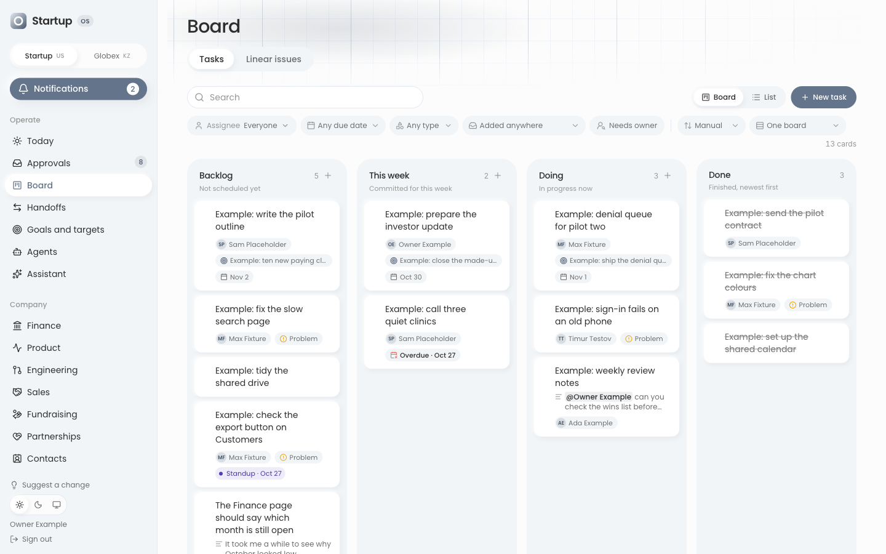

**For:** the team's tasks. Two tabs: *Tasks* (the app's own board) and *Linear issues* (a
read-only copy of your Linear board, if you connect Linear).

**Columns:** *Backlog* (not scheduled yet), *This week* (committed for this week), *Doing* (in
progress now) and *Done* (finished, newest first). A card is a task or a *Problem*. Search,
filters (for example *Needs owner*), the sort and the layout live in the address, so a link
keeps them.

**Who uses it:** everyone with the board page. Anyone with it can add, move, edit and archive
cards.

**What fills it:**

- people, on the page;
- a message to the Telegram bot (`/task …` in a group you picked);
- the standup script, which turns a meeting summary into Backlog cards;
- *Suggest a change* in the sidebar, which adds a card labelled as feedback;
- *Add to board* on a meeting's action item in Memory;
- agents and bots: directly with the right permission, or as a proposal you approve.

### Handoffs

`/handoffs` · the *board* page

**For:** work one bot hands to another bot or to a person: who asked whom, for what, and where
it stands (*open*, *accepted*, *done*, *declined*, *closed*).

**Who uses it:** the person a handoff is addressed to accepts, declines (with a reason) or marks
it done. The owner and anyone with the board can hand it to someone else; only the owner can
close it.

**What fills it:** bots only. If a handoff may carry money figures, a person sees *withheld*
unless they have every money page the sending bot reads. The page is empty until you connect
a bot that hands work over.

### Goals and targets

`/goals` · goals with the *scorecard* or *board* page; targets with *scorecard* or *settings*

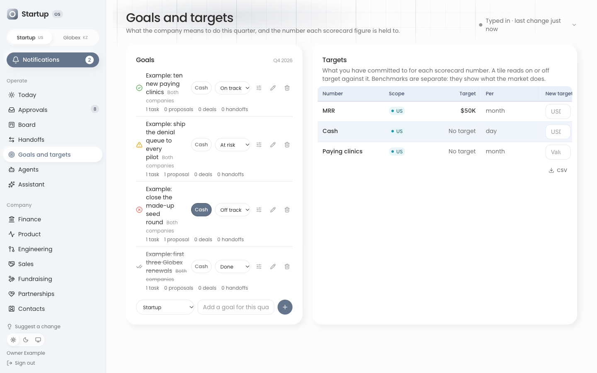

**For:** *"What the company means to do this quarter, and the number each scorecard figure is
held to."*

- **Goals:** each has a title, a status (*on track*, *at risk*, *off track*, *done*), a
  quarter, and optionally an owner, an owner bot, a target in words and a due day. Each shows
  how many tasks, proposals, deals and handoffs are linked to it. Editing goals needs the
  *Editing goals* page (the `review` area).
- **Targets:** the number you commit to for each scorecard figure, for example MRR of $50K a
  month. Setting a target needs the sensitive *settings* page.

**What fills it:** people. Agents and bots can only propose a new goal or a change to one.

### Agents

`/agents` · the *agents* page (the engineer and the co-founder start with it)

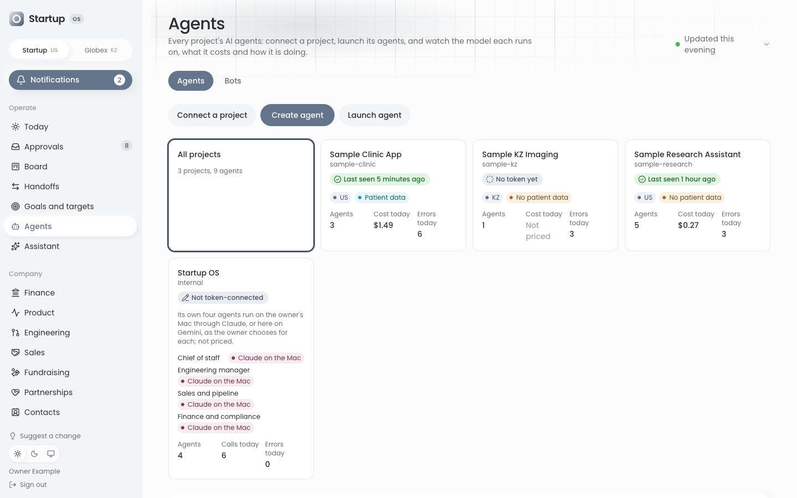

**For:** *"Every project's AI agents: connect a project, launch its agents, and watch the model
each runs on, what it costs and how it is doing."*

- **Agents tab:** buttons to *Connect a project*, *Create agent* and *Launch agent*; the app's
  own four agents (the owner only); and a table per connected project with each agent's model,
  cost against its monthly budget, calls in the last 7 days, error rate and speed. An opened
  agent shows its instructions, tests, versions and runs.
- **Bots tab** (the owner only): every bot you have added, its calls, errors, cost and what it
  may read and write, page by page. *Add a bot* and *Make a token for this bot* are here.

**What fills it:** projects you connect (each gets a token, shown once, and reports once a
day; `docs/agents-protocol.md` is the contract), and the app's own agents.

### Assistant

`/assistant` · the owner's alone

**For:** *"Work with your own Claude in Startup OS."* A chat, the archive of daily briefs, what the
agents did this week, and a switch per agent.

**What fills it:** the chat is answered by Claude Code on the owner's Mac, through
`pnpm assistant:runner`. Nothing answers while that Mac is off. Connecting other clients
(Claude Code, claude.ai) is on Settings › Connections. [`docs/assistant.md`](../assistant.md)
is the full description.

---

## Company

### Finance

`/finance` · the *finance* page

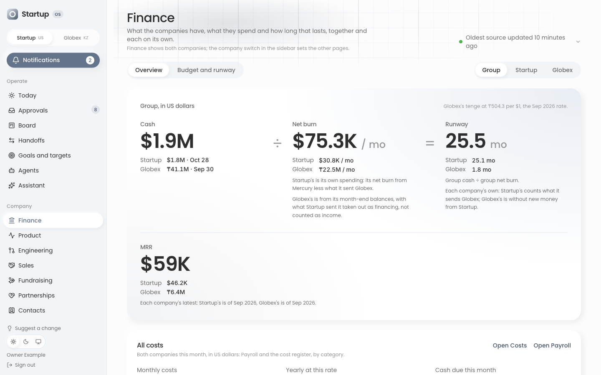

**For:** what the company has, what it spends and how long that lasts.

**Overview tab, top to bottom:**

1. **Cash ÷ net burn = runway**, with MRR below. Each figure names its source and date; a
   figure not read yet says *Not known yet*.
2. **All costs:** payroll plus the cost register: *Monthly costs*, *Yearly at this rate*, *Cash
   due this month*. Anyone but the owner sees *On the Payroll page* in place of the figures.
3. **Unit economics:** revenue per customer, gross margin, customer acquisition cost (CAC),
   payback, lifetime value (LTV) and LTV:CAC.
4. **Where the money goes:** the last six finished months.
5. **Plan against reality**, against a financial model you push.
6. **Runway and what changes it:** scenarios, linked to the Budget tab.
7. **Revenue health**, and **Record a figure** at the foot (people with the *settings* page),
   for numbers with no system to read them from, such as MRR.

**Budget and runway tab:** a monthly budget per category that fills itself from Payroll and
Costs (a typed cell overrides it), up to 10 runway scenarios, and a 24-month projection. The
payroll and cost rows are the owner's only.

**What fills it:** the bank (Mercury, with `MERCURY_API_TOKEN`, read daily), figures typed in
under *Record a figure*, a pushed financial model (`financial_model`), and the Payroll, Costs
and Customers pages.

**Switches:** `secondCompany` adds the *Group* view in the picture (both companies added
together). `subsidiaryFunding` treats money the first company sends the second as financing,
not income. `kztCurrency` lets people type amounts in tenge.

### Product

`/product` · the *product* page

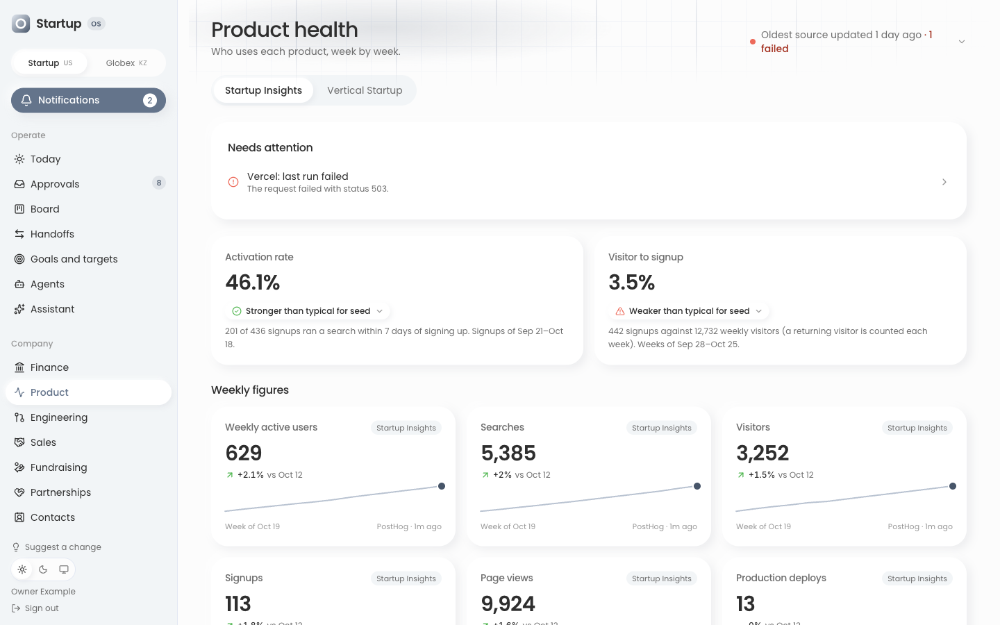

**For:** *"Who uses each product, week by week."* A tab per product, with weekly figures
(active users, signups, activation) against benchmarks.

**As shipped:** every product tab is switched off, so the page says *"No product is
connected yet."* Showing your own product here, under its own name, is a code change today
(`src/lib/metrics/products.ts`, the metric registry and a connector; see
[Make it yours](customize.md#add-a-data-source)). An easier way is **not available yet**.

**Switches:** each turns on one example tab you can adapt.

- `startupInsights`: a search product's tab (the one in the picture), read from PostHog and
  Vercel.
- `verticalStartupProduct`: a product read from a health address it serves
  (`VERTICAL_HEALTH_URL` and `VERTICAL_HEALTH_SECRET`).
- `kzProduct`: the second company's app (needs `secondCompany`).

### Engineering

`/engineering` · the *engineering* page (the engineer and the co-founder start with it)

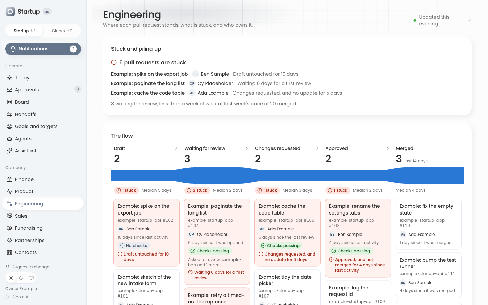

**For:** *"Where each pull request stands, what is stuck, and who owns it."* Blocks: *Stuck and
piling up*, *The flow*, *By owner* and *All pull requests*. It shows no per-person output
figures.

**What fills it:** a push only. `pnpm gather:github --send` counts pull requests through the
GitHub command-line tool on a machine you control, for the organisations listed in
`GITHUB_ORGS` (`convex/lib/features.ts`, empty as shipped).

### Sales

`/sales` (and a page per deal) · the *sales* page

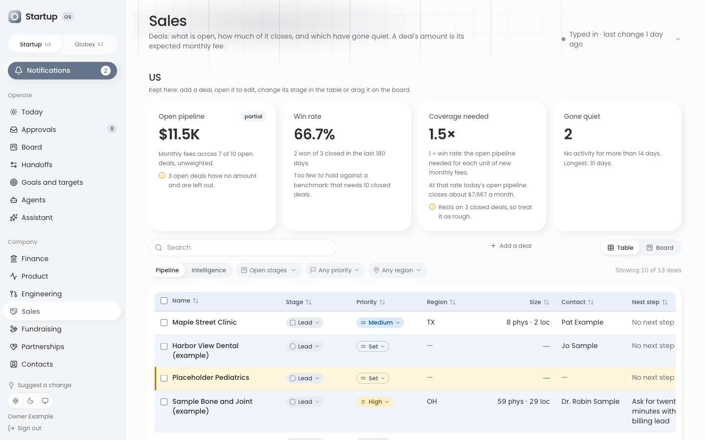

**For:** *"Deals: what is open, how much of it closes, and which have gone quiet. A deal's
amount is its expected monthly fee."* A table or a board; stages *lead*, *qualified*, *demo*,
*proposal*, *won*, *lost*. Each deal has its own page with the next best action, signals, the
people involved, pains and risks, and the outcomes of anything a bot tried on it.

**What fills it:** people; agents and bots (a deal's next step, a new deal, as proposals; or
directly with permission); and two import scripts (`pnpm import:prospects`,
`pnpm import:intel`). A won deal becomes a customer.

**Switches:** `secondCompany` adds a second market's section, mirrored from its own CRM.

### Fundraising

`/fundraising` (and a page per investor) · the *fundraising* page, first company only

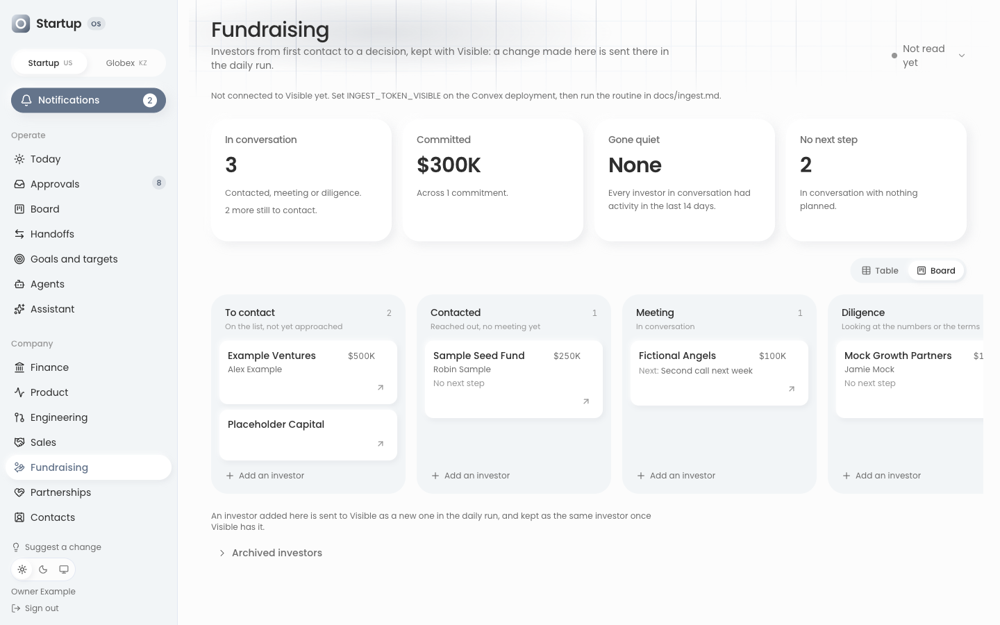

**For:** investors from first contact to a decision. Stages *target*, *contacted*, *meeting*,
*diligence*, *committed*, *passed*. A board or a table.

**What fills it:** people; agents and bots; and Visible, the investor-relations tool, both ways:
a daily push brings investors in (`INGEST_TOKEN_VISIBLE`), and a change made here is queued to
be written back.

### Partnerships

`/partnerships` · the *partnerships* page (only the co-founder starts with it)

**For:** *"Channel, integration, referral, strategic and design partners, from first contact to
live."* Stages *identified*, *contacted*, *in talks*, *agreement*, *live*, *paused*, *lost*. A
partner in conversation with no activity for two weeks is marked quiet.

**What fills it:** people, and bots with permission. Nothing mirrors it from another tool.

### Contacts

`/contacts` · the *contacts* page, ticked per person (no role starts with it)

**For:** the company's business contacts: search by name, email or organisation, filter by
category or owner, and link a contact to an investor, a partner or a deal.

**What fills it:** people; contacts pushed alongside Visible, Apollo, Gmail, Calendar and
Fireflies data; and bots with permission. It holds real people's details, which is why no
role starts with it.

### Customers

`/customers` · the *customers* page

**For:** every customer with a health verdict (*Good*, *Watch*, *At risk*, *Unknown*, *Not
assessed*) and the reason for it. Payment figures show only to people with Finance.

**What fills it:** a deal won on Sales becomes a customer here; people and bots add a note and
the next time to get in touch. **As shipped,** that is the only way in: pushing a full client
register is part of the `secondCompany` feature, so the page's hint to run
`pnpm push:customers` only works with that switch on.

### Compliance

`/compliance` · the *compliance* page

**For:** *"What has to be done, by when, and where the proof is. This page tracks dates and
evidence. It does not say whether the company meets any standard."* Tabs: *Dates*,
*Questionnaires*, *Answer bank*, *Vendor agreements*, *Evidence*. A date nobody has confirmed
says *Unconfirmed* and never counts as due. There is a starter checklist.

**What fills it:** people, and bots with permission (for example, a bot that fills in a security
questionnaire from the answer bank).

### Go to market

`/gtm` · the *go to market* page, first company only

**For:** *"Who finds Startup, the outbound that goes after the rest, the meetings it books and the
pipeline they create."*

- **Inbound** (people who also have the *marketing* page): Google Search Console and audience.
- **Outbound:** Apollo's sequences, emails delivered, opened and replied, and meetings booked.

**What fills it:** Apollo (`APOLLO_API_KEY`, read daily, or pushed), Search Console (`GSC_*`,
read daily), and figures typed in (meetings booked, LinkedIn followers).

### LinkedIn

`/linkedin` · the *go to market* page

**For:** a calendar of LinkedIn posts: ideas, drafts, scheduled and published posts, how each
did, and a weekly target. *"Nothing is posted from here."*

**What fills it:** people and bots. The app does not connect to LinkedIn itself.

### Memory

`/memory` · the *memory* page (the co-founder starts with it)

**For:** *"What the company decided and why, who owns each decision and when to look at it
again, the notes of the meetings where it happened, and notes that are not a meeting's."* Tabs:
decisions, meetings, notes. A decision is *proposed*, *decided*, *revisit* or *reversed*; on
its revisit date it comes back to its owner. A meeting's action item can go straight to the
board.

**What fills it:** people; the owner's meeting notes from Fireflies; agents and bots (a
decision or a note, as a proposal or directly with permission).

### Payroll

`/payroll` · the owner's alone, always

**For:** *"What Startup pays its people each month."* One table per month with *Mark as paid*
(which freezes it) and *Reopen*. *"It is not tax advice."*

**What fills it:** the owner, typing. No token, agent or bot can ever read it.

### Costs

`/costs` · the owner's alone, always

**For:** what the company pays for besides pay: cloud, subscriptions, rent. Each line is
monthly, quarterly, yearly or once. Figures: *Run-rate*, *Cash due*, *Run-rate incl. pay*.
*"No card or account numbers belong here."*

**What fills it:** the owner, typing. The owner's own Claude can read the lines through a
read-only tool; bots cannot.

---

## Settings

### Settings › Sources

`/settings/sources` · the sensitive *settings* page

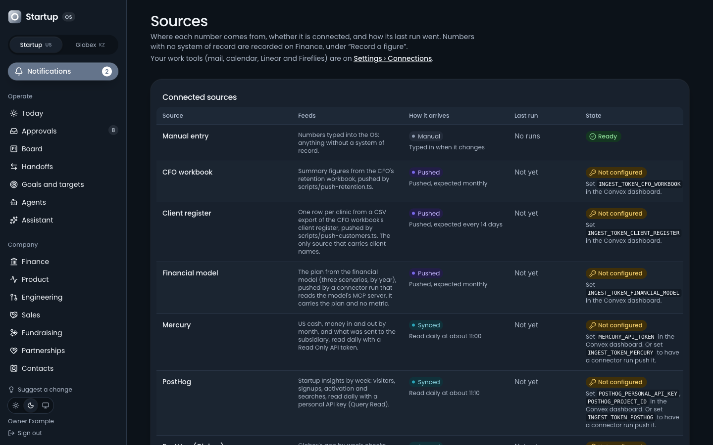

**For:** *"Where each number comes from, whether it is connected, and how its last run went."*
A table of every source: what it feeds, how it arrives (*Manual*, *Pushed*, *Synced*), the
last run and its state (*On time*, *Late*, *Out of date*, *Failed*, *Not read yet*). *Run now*
starts a sync at once. Recent runs are listed below.

### Settings › Connections

`/settings/connections` · *today* for your own part; the rest is the owner's

**For:** one place to connect things.

- *Send your tools to Startup OS:* a teammate with the *today* page makes their own token here and
  gets a prompt for their own Claude to send their mail, calendar and notes each day. The owner
  connects Google directly and switches each work tool on or off.
- *Let Claude read Startup OS* (the owner only): the connected AI clients, each *Read only* or
  *Read and act*, with *Revoke*, and the recent calls they made.

### Settings › Team

`/settings/team` · the sensitive *team* page

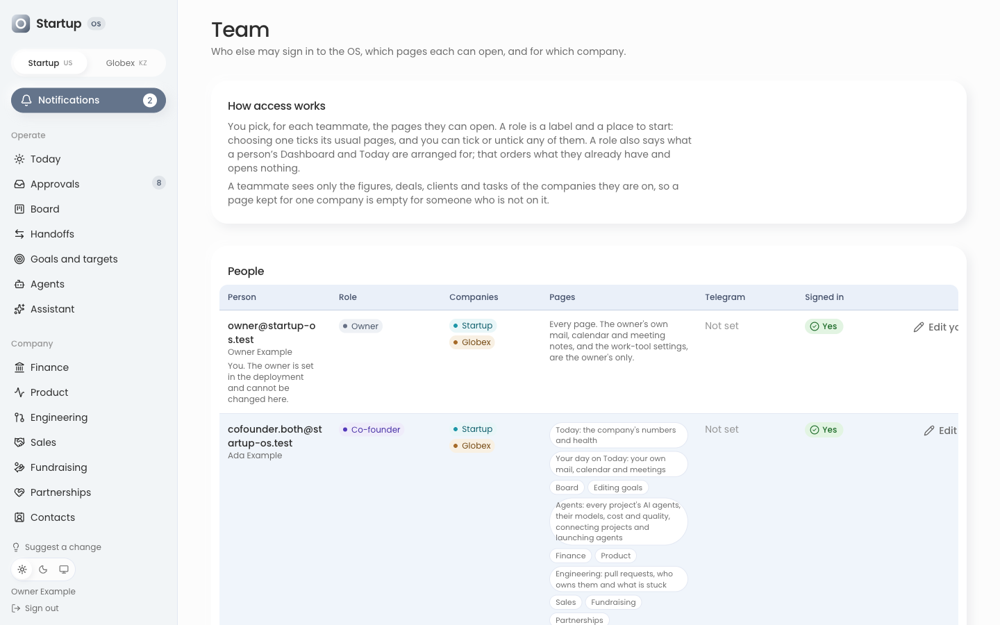

**For:** who is let in, on which company, with which pages. Panels: *How access works*,
*People*, *Roles* (the owner only), *Add a teammate* (up to 50 people) and *Recent changes*.
[Your first week](first-week.md#day-2-invite-the-team) walks through adding someone.

Someone the owner gives this page to (a *manager*) can add and remove people and choose their
ordinary pages, within their own companies. They can never give the sensitive pages, change
another manager or change themselves.

### Settings › Telegram

`/settings/telegram` · the sensitive *settings* page

**For:** the Telegram bot (`TELEGRAM_BOT_TOKEN`). Pick a group for the company (the owner),
send a test message, turn messages and commands on or off. The bot tells a person when a task
is assigned to them, and turns `/task …` in a group into a card on the board.

---

## Addresses that only redirect

| Address | Goes to | Why |
|---|---|---|
| `/review` | Today | The weekly review page is put away for now. Not available yet. |
| `/today` | Today (`/`) | Today and the old dashboard are one page. |
| `/marketing` | Go to market | Marketing is the inbound half of that page. |
| `/today/connect`, `/assistant/connection`, `/settings/work-tools` | Settings › Connections | One place to connect things. |

## Pages that need a switch

With every switch off, as shipped, these do not exist (the address says "not found"):

| Page | Switch | What it is |
|---|---|---|
| `/support` | `supportInbox` (needs `secondCompany`) | The second company's Intercom inbox: who waits on a person, and how the AI agent does. |
| `/product/kz/…` | `kzProduct` (needs `secondCompany`) | A page per customer of the second company's app. |

[Make it yours](customize.md#turn-features-on) says how to turn a switch on.
